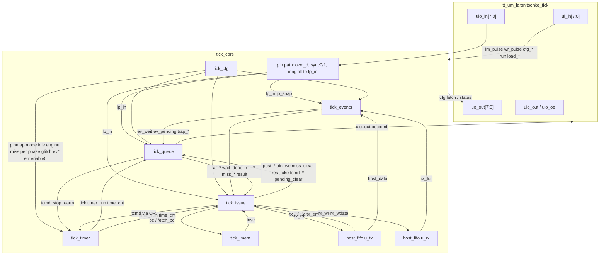

# Tick architecture inventory

Teaching document for the Tiny Tapeout Tick soft peripheral. Signal names and widths are taken from the RTL under `src/`. Line references use the form `file:line`. Cell counts are from Yosys hierarchical `stat` after `proc; opt` (abstract cells) plus a flattened techmapped total from `make synth`.

**Sources:** `src/*.sv`, `docs/isa.md`, `sw/tick/iss.py`, `verification/**`. Scenario cycle tables are from the Python ISS (`Machine.step`) with programs matching the cocotb tests; WaveDrom diagrams summarise the same runs.

---

## 1. System overview

Tick is a single-context (today) timed bit-engine peripheral for Tiny Tapeout: the host loads a short program and configuration over a parallel nibble bus on `ui_in`/`uio` while `RUN=0`, then raises `RUN` so the core issues one instruction per cycle, posts timed pin/bit operations into a two-slot queue, and drives eight bidirectional protocol pins on `uio[7:0]`. A fractional timer (or, when wired, a pin-edge) emits **ticks**; the queue consumes one timed op per tick (SET.T / IN.T / XFER / tick-WAIT), while events/traps, host FIFOs, and ALU/control instructions run in the same cycle schedule. The design goal is cycle-accurate match against the instruction-set simulator in `sw/tick/iss.py`.

### 1.1 Module block diagram



### 1.2 Inter-module signals

| name | width | from → to | meaning |
|---|---|---|---|
| `clk` / `rst_n` | 1 / 1 | pads → all | system clock; async active-low reset |
| `run` | 1 | top `ui_in[3]` → core | host run enable |
| `internal_run` | 1 | core (`run & enable0`) → timer/events/queue | context running (`tick_core.sv:160`) |
| `imem_we` / `imem_waddr` / `imem_wdata` | 1 / 6 / 16 | top → imem | pulsed write while !run (`tt_um_larsnitschke_tick.sv:32–34,102–104`) |
| `host_wr` / `host_wdata` | 1 / 10 | top → `u_tx` | host→core FIFO push |
| `host_rd` / `host_rdata` / `host_empty` / `host_full` | 1 / 10 / 1 / 1 | `u_rx`/top ↔ host | core→host pop; registered `host_rdata` (`tick_core.sv:66–74`) |
| `cfg_we` / `cfg_re` / `cfg_addr` / `cfg_wdata` / `cfg_rdata` | 1/1/8/8/8 | top ↔ cfg | config write/read port |
| `enable0` | 1 | cfg → core | ENABLE bit0 |
| `pinmap0..3` | 3×4 | cfg → queue/core | LP→physical map |
| `pinmode0..3` | 2×4 | cfg → queue | in / PP / OD |
| `pinidle` | 4 | cfg → queue | idle levels after trap/MISS |
| `dout_lp` / `din_lp` / `clk_lp` | 2/2/2 | cfg → queue/issue | engine pin indices |
| `msb_first` / `clk_en` / `cpol` / `cpha` | 1×4 | cfg → queue/issue | ENGINE/CLKCFG |
| `tick_src` / `tick_rise` / `tick_pin` | 1/1/2 | cfg → (stored) | TICK register; pin-edge not fully wired |
| `miss_pol` / `miss_vec` / `default_byte` | 2/6/8 | cfg → queue/issue | MISS policy / default |
| `per_fp` / `phase_cfg` | 20 / 16 | cfg → timer | period (Q4) and phase |
| `glitch` | 4 | cfg → core pin path | per-LP majority enable |
| `ev0..3_cfg` / `ev0..3_trap` | 8×8 | cfg → events | event selectors |
| `err_bits` | 8 | cfg → issue (MISS OR'd in core) | sticky errors |
| `err_map/overrun/arb_set` | 1×3 | queue → cfg | sticky set pulses |
| `err_under_set` / `err_clear` / `err_clear_mask` | 1/1/8 | issue → cfg | UNDER + W1C |
| `per_we` / `per_sel` / `per_wdata` | 1/2/8 | issue → cfg | MTS PER_* |
| `phase_we` / `phase_hi` / `phase_wdata` | 1/1/8 | issue → cfg | MTS PHASE_* |
| `ecfg_we` / `ecfg_wdata` | 1/8 | issue → cfg | MTS ECFG |
| `tick` / `tick_r` / `timer_run` / `time_cnt` | 1/1/1/16 | timer → queue/issue/dbg | comb tick, registered tick, run, time |
| `t_start` / `t_stop` / `t_rearm` | 1×3 | issue∨queue → timer | timer commands (`tick_core.sv:171–185`) |
| `lp_in` | 4 | sync → events/queue/issue | logical inputs after sync(/glitch) |
| `lp_snap` | 4 | core → events | RUN-rise prev-sample (`tick_core.sv:266–270`) |
| `host_data` / `host_space` | 1/1 | FIFOs → events | `!tx_empty` / `!rx_full` |
| `ev_live` / `ev_wait` / `ev_pending` | 4/4/4 | events → issue/queue | live, WAIT-visible, latched pending |
| `event_trap_req` / `event_trap_vec` / `event_trap_bit` | 1/6/4 | events → queue/issue/imem mux | trap request |
| `tick_eff` | 1 | core → queue | `tick & ~event_trap_req` (`tick_core.sv:304`) |
| `trap_cancel` | 1 | = event trap → queue | cancel queue + idle pins |
| `at_a_kind` / `at_p_kind` / `at_slots_full` | 2/2/1 | queue → issue | after-tick slot kinds |
| `event_wait_done` / `tick_wait_done` | 1/1 | queue → issue | WAIT completion pulses |
| `in_t_done` / `in_t_bit` | 1/1 | queue → issue | IN.T sample this cycle |
| `a_kind` / `p_kind` / `miss` / `miss_comb` | 2/2/1/1 | queue → issue/dbg | registered kinds; sticky/same-cycle miss |
| `res_valid` / `result` | 1/16 | queue → issue | bit-engine result |
| `miss_trap_req` | 1 | queue → issue | MISS policy=TRAP |
| `post_*` / `pin_we` / `pin_*` / `miss_clear` / `res_take` | various | issue → queue | posts / immediate SET / clears |
| `pending_clear_en` / `pending_clear_mask` | 1/4 | issue → events | EVCLR / wait / trap clear |
| `waiting` / `wait_mask` / `wait_tc` / `pull_block` / `mfs_block` | 1/5/2/1/1 | issue → queue | stall state |
| `pc` / `fetch_pc` / `instr` | 6/6/16 | issue ↔ imem | PC; trap/miss redirect; instruction |
| `tx_rd` / `tx_rdata` / `tx_empty` | 1/10/1 | issue ↔ u_tx | PULL |
| `rx_wr` / `rx_wdata` / `rx_full` | 1/10/1 | issue ↔ u_rx | PUSH |
| `uio_out` / `uio_oe` / `uio_*_comb` | 8×4 | queue → core/top | registered pads + comb for own-sample |
| `dbg_*` | various | core → top `uo_out` when run | status |

---

## 2. Modules (data-flow order)

Hierarchical Yosys abstract cells after `proc; opt` (local / share of **7447**). Flattened techmapped `make synth` total: **10713** cells.

### 2.1 `tt_um_larsnitschke_tick`

**Purpose.** Chip top: parallel load nibbles, edge pulses, OE gate when !run, `uo_out` mux. Implements `docs/isa.md` §2 parallel load; pinout in `tt_um_larsnitschke_tick.sv:7–16`.

**Ports:** `ui_in[7:0]`, `uo_out[7:0]`, `uio_in/out/oe[7:0]`, `ena`, `clk`, `rst_n` (`:21–29`).

**State** (`:37–44`, reset `:55–65`): `load_addr[5:0]=0`, `load_word[15:0]=0`, `host_word[9:0]=0`, `prev_wr/imem/f/8=0`, `cfg_addr_latch[7:0]=0`, `cfg_rdata_latch[7:0]=0`, `cfg_re_d=0`.

**Logic:** one `always @(posedge)` for latches/pulses (`:54–90`); assigns for `run`, pulses, `uo_out`, `uio_oe` (`:31–49`, `:129–135`).

**Cells:** local 63 / incl. 7447 → **0.8%** local.

**ISS:** host load outside Machine; `Machine.load` / `cfg_write` / `host_push`.

### 2.2 `tick_core`

**Purpose.** Wire-up + shared pin sync path (own delay + 2-flop + majority + LP demux + RUN-rise snap). `docs/isa.md` §1 read-back latency / §2 synchronisers.

**Ports:** `tick_core.sv:6–34`.

**State (pin path)** (`:206–227`): `own_d[7:0]=0xFF`, `sync0/1=0xFF`, `maj0/1/2=0xFF`, `run_q_sync=0`, `host_rdata[9:0]=0`.

**Logic:** `pin_raw` (`:249`), `filt` (`:250`), `lp_in` (`:259–262`), `tick_eff`/`trap_cancel` (`:304–305`), timer cmd OR (`:171–185`), `fetch_pc` mux (`:405–407`).

**Cells:** local 91 → **1.2%**.

**ISS:** `step` sync (`iss.py:1151–1161`), `_sample_pins_for_sync`, `_shift_own_delay`, `_snap_inputs_after_enable`.

### 2.3 `host_fifo` ×2

**Purpose.** Depth-8 × 10-bit host FIFOs. `docs/isa.md` §2.

**Ports:** `host_fifo.sv:17–24`. **State:** `mem_q`, `wptr_q`, `rptr_q`, `count_q` reset 0. **Logic:** comb `do_wr`/`do_rd` (`:39–55`); seq (`:57–70`).

**Cells:** **60 each** (1.6% both). **ISS:** `host_push`/`host_pop`, PULL/PUSH.

### 2.4 `tick_imem`

**Purpose.** 64×16, sync write, async read. `docs/isa.md` §2. **Ports:** `tick_imem.sv:6–14`. **State:** `mem[0:63]=0`. **Logic:** `rdata=mem[raddr]` (`:17`).

**Cells:** **321** → **4.3%**. **ISS:** `Machine.imem`.

### 2.5 `tick_cfg`

**Purpose.** Config map §2.1; MTS PER/PHASE/ECFG/ERR. **Ports:** `tick_cfg.sv:8–72`.

**State (resets `:165–200`):** `enable_q=0`; sticky errs=0; `c0_pinmap_lo=0x10`, `hi=0x32`; `pinmode=0`; `pinidle=0x0F`; `engine=0x04`; `clkcfg/tick/miss=0`; `c0_default=0xFF`; `per_l=0x80` (PER=8.0); phase=0; base/bound/glitch/ev*=0; `c1_mem[*]=0`; `cfg_rdata=0`.

**Logic:** decoded wires (`:89–124`); `read_c0` (`:132–163`); write in seq block.

**Cells:** **587** → **7.9%**. **ISS:** `cfg_write`/`cfg_read`/`_apply_cfg_byte`/`configure`.

### 2.6 `tick_timer`

**Purpose.** Fractional PER/PHASE; comb `tick` from regs. `docs/isa.md` §1 rules 4–5.

**Ports:** `tick_timer.sv:7–22`. **State:** `accum_q[19:0]=0`, `phase_left_q[15:0]=0`, `timer_run_q=0`, `time_cnt_q=0`, `tick_r=0`.

**Logic:** tick detect (`:41–53`); next-state with `start&&!timer_run_d` after stop (`:55–92`); seq (`:94–108`).

**Cells:** **76** → **1.0%**. **ISS:** `_emit_tick`, `_start_timer`, `_stop_timer`, `_ensure_timer_for_timed`.

### 2.7 `tick_events`

**Purpose.** 4 selectors: live, LATCHED pending, WAIT visibility, trap priority, RUN-rise pin-trap suppress.

**Ports:** `tick_events.sv:5–32`. **State:** `lp_prev_q=0xF`, `pending_q=0`, `run_q=0`.

**Logic:** `live_of` (`:48–74`); `ev_wait` (`:98–101`); trap loop (`:112–127`); seq pending/lp_prev (`:132+`).

**Cells:** **203** → **2.7%**. **ISS:** `_event_active`, `_event_for_wait`, `_update_ev_pending`, `_check_traps`, `_clear_ev_pending`.

### 2.8 `tick_queue`

**Purpose.** Two-slot queue, bit engine, LP→phys mux, MISS policies. `docs/isa.md` §1 queue, §3–4.

**Ports:** `tick_queue.sv:7–82`. **State:** `a_kind`/`p_kind` and slot fields (`:62–100`); `drv_val_q`/`drv_oe_q`; `miss`/`res_valid`/`result`; `stretching_q`; `uio_out`/`uio_oe`; err pulses.

**Logic:** (1) after-tick `always @*` (`:181+`); (2) post/pin/map `always @*` (`:443+`); (3) seq (`:556+`).

**Cells:** **2971** → **39.9%**. **ISS:** `_post_timed`, `_promote`, `_on_tick`, `_apply_miss`, `_engine_bit`, `_drive_lp`, `_apply_drives`.

### 2.9 `tick_issue`

**Purpose.** PC, decode, r0–r3, flags, WAIT/PULL/MFS, posts, traps. `docs/isa.md` §3.

**Ports:** `tick_issue.sv:5–82`. **State:** `rf_q[0:3]`, `z_q`/`c_q`/`last_f_q`/`cmd_f_q`, `evf_q[4:0]`, `time_h_latch_q`, `waiting_q`/`wait_mask_q`/`wait_tc_q`, `pull_block_q`/`pull_rd_q`, `mfs_block_q`/`mfs_rd_q`, `pc_q` — reset 0 (`:85–96`).

**Logic:** `comb_issue` (`:130+`); `seq_issue` (`:585+`).

**Cells:** **3015** → **40.5%**. **ISS:** `_exec`, `_alu`, `_eval_cond`, `_read_spr`/`_write_spr`, `_service_waits`, `_do_trap`.

---

## 3. One clock cycle, step by step

### 3.1 RTL order

1. Sync regs (prior cycle) → `lp_in` (`tick_core.sv:219–262`).
2. Events → `ev_wait`, `trap_req` (`tick_events`).
3. Timer → comb `tick` (`tick_timer.sv:41–53`).
4. `tick_eff = tick & ~event_trap_req` (`tick_core.sv:304`).
5. Queue after-tick → `at_*`, `*_wait_done`, `in_t_*`, `miss_comb`, `tcmd_stop/rearm`.
6. IMEM at `fetch_pc` (`tick_core.sv:405–407`) → `instr`.
7. Issue → posts, `pin_we`, `tcmd_start`, PC.
8. Queue post/map → place posts after tick; `map_out`/`map_oe`.
9. Timer next-state merges issue/queue cmds (`tick_core.sv:171–185`).
10. Clock: commit all regs; advance sync pipeline.

### 3.2 ISS `Machine.step()` (`iss.py:1151–1216`)

1. Sync shift from `_pin_sample`. 2. `_update_ev_pending` + `_check_traps`. 3. `_emit_tick` / `time++`. 4. `_try_event_complete_wait` → `_on_tick` → `_service_waits`. 5. `_exec`. 6. `_apply_drives`; sample; `_shift_own_delay`.

### 3.3 Same-cycle rules

| rule | RTL | ISS |
|---|---|---|
| Post after tick | queue comb2 after after-tick | `_post_timed` after `_on_tick` |
| Tick-WAIT / EVF TICK | `tick_wait_done` + issue | `_on_tick` / wait complete with tick |
| JMP sees same-cycle MISS/IN.T | `miss_comb` in `err_bits[0]` (`tick_core.sv:441`); `in_t_*` | tick/miss before `_exec` |
| Trap priority / cancel / stop timer | events trap loop; `trap_cancel`; `tcmd_stop` | `_check_traps` before emit; `_do_trap` |
| Event trap suppresses tick | `tick_eff` | traps before `_emit_tick` |
| Trap+SET.T restarts timer | `start&&!timer_run_d` (`tick_timer.sv:83–90`) | `_ensure_timer_for_timed` |

---

## 4. Traced scenarios

ISS traces; cocotb RTL uses ALIGN=1 on pad outputs. Queue shown as `active/pending`.

### 4a. UART TX (`sw/programs/uart_tx.asm`)

PER=8, PHASE=0, LP0 PP idle1, EV0=HOST_DATA; host `0x55` LAST. Start bit on tick **cy=10**.

| cycle | pc | instruction | tick | queue a/p | flags | pins |
|---|---|---|---|---|---|---|
| 0 | 0 | WAIT `2020` | 0 | empty/empty | w=1 miss=0 stretch=0 | evf=00 pend=0 | oe=01 out=01 tx=1 lp=1111 |
| 1 | 1 | PULL `7000` | 0 | empty/empty | w=0 miss=0 stretch=0 | evf=01 pend=0 | oe=01 out=01 tx=1 lp=1111 |
| 2 | 2 | SET `0840` | 0 | set/empty | w=0 miss=0 stretch=0 | evf=01 pend=0 | oe=01 out=01 tx=1 lp=1111 |
| 3 | 3 | XFER `61c0` | 0 | set/xfer | w=0 miss=0 stretch=0 | evf=01 pend=0 | oe=01 out=01 tx=1 lp=1111 |
| 4 | 4 | SET `0844` | 0 | set/xfer | w=0 miss=0 stretch=0 | evf=01 pend=0 | oe=01 out=01 tx=1 lp=1111 |
| 5 | 4 | SET `0844` | 0 | set/xfer | w=0 miss=0 stretch=0 | evf=01 pend=0 | oe=01 out=01 tx=1 lp=1111 |
| 6 | 4 | SET `0844` | 0 | set/xfer | w=0 miss=0 stretch=0 | evf=01 pend=0 | oe=01 out=01 tx=1 lp=1111 |
| 7 | 4 | SET `0844` | 0 | set/xfer | w=0 miss=0 stretch=0 | evf=01 pend=0 | oe=01 out=01 tx=1 lp=1111 |
| 8 | 4 | SET `0844` | 0 | set/xfer | w=0 miss=0 stretch=0 | evf=01 pend=0 | oe=01 out=01 tx=1 lp=1111 |
| 9 | 4 | SET `0844` | 0 | set/xfer | w=0 miss=0 stretch=0 | evf=01 pend=0 | oe=01 out=01 tx=1 lp=1111 |
| 10 | 4 | SET `0844` | 1 | xfer/set | w=0 miss=0 stretch=0 | evf=01 pend=0 | oe=01 out=00 tx=0 lp=1111 |
| 11 | 5 | JMP `3d20` | 0 | xfer/set | w=0 miss=0 stretch=0 | evf=01 pend=0 | oe=01 out=00 tx=0 lp=1111 |
| 12 | 8 | WAIT `2a00` | 0 | xfer/set | w=0 miss=0 stretch=0 | evf=01 pend=0 | oe=01 out=00 tx=0 lp=1111 |
| 13 | 8 | WAIT `2a00` | 0 | xfer/set | w=0 miss=0 stretch=0 | evf=01 pend=0 | oe=01 out=00 tx=0 lp=0111 |
| 14 | 8 | WAIT `2a00` | 0 | xfer/set | w=0 miss=0 stretch=0 | evf=01 pend=0 | oe=01 out=00 tx=0 lp=0111 |
| 15 | 8 | WAIT `2a00` | 0 | xfer/set | w=0 miss=0 stretch=0 | evf=01 pend=0 | oe=01 out=00 tx=0 lp=0111 |
| 18 | 8 | WAIT `2a00` | 1 | xfer/set | w=0 miss=0 stretch=0 | evf=01 pend=0 | oe=01 out=01 tx=1 lp=0111 |
| 26 | 8 | WAIT `2a00` | 1 | xfer/set | w=0 miss=0 stretch=0 | evf=01 pend=0 | oe=01 out=00 tx=0 lp=1111 |
| 34 | 8 | WAIT `2a00` | 1 | xfer/set | w=0 miss=0 stretch=0 | evf=01 pend=0 | oe=01 out=01 tx=1 lp=0111 |
| 42 | 8 | WAIT `2a00` | 1 | xfer/set | w=0 miss=0 stretch=0 | evf=01 pend=0 | oe=01 out=00 tx=0 lp=1111 |
| 50 | 8 | WAIT `2a00` | 1 | xfer/set | w=0 miss=0 stretch=0 | evf=01 pend=0 | oe=01 out=01 tx=1 lp=0111 |
| 58 | 8 | WAIT `2a00` | 1 | xfer/set | w=0 miss=0 stretch=0 | evf=01 pend=0 | oe=01 out=00 tx=0 lp=1111 |
| 66 | 8 | WAIT `2a00` | 1 | xfer/set | w=0 miss=0 stretch=0 | evf=01 pend=0 | oe=01 out=01 tx=1 lp=0111 |
| 74 | 8 | WAIT `2a00` | 1 | set/wait | w=1 miss=0 stretch=0 | evf=01 pend=0 | oe=01 out=00 tx=0 lp=1111 |
| 82 | 9 | JMP `3000` | 1 | wait/empty | w=1 miss=0 stretch=0 | evf=01 pend=0 | oe=01 out=01 tx=1 lp=0111 |
| 90 | 9 | JMP `3000` | 1 | empty/empty | w=0 miss=0 stretch=0 | evf=10 pend=0 | oe=01 out=01 tx=1 lp=1111 |

```json
{"signal":[
 {"name":"tick","wave":"0.........1.......1"},
 {"name":"a_kind","wave":"x2..3.............","data":["SET","XFER"]},
 {"name":"p_kind","wave":"x.3.2.............","data":["XFER","SET"]},
 {"name":"uio_out[0]","wave":"1.........0.......1"},
 {"name":"evf0","wave":"0.1..............."}
]}
```

### 4b. UART RX (`sw/programs/uart_rx.asm`)

PER=8, PHASE=4, EV0 fall LATCHED, EV1 level-high; frame `0x55`.

| cycle | pc | instruction | tick | queue a/p | flags | lp |
|---|---|---|---|---|---|---|
| 12 | 1 | IN `1800` | 0 | empty/empty | w=1 miss=0 stretch=0 | evf=00 pend=0 | oe=00 out=00 tx=- lp=1000 |
| 13 | 1 | IN `1800` | 0 | empty/empty | w=1 miss=0 stretch=0 | evf=00 pend=0 | oe=00 out=00 tx=- lp=1000 |
| 14 | 1 | IN `1800` | 0 | empty/empty | w=1 miss=0 stretch=0 | evf=00 pend=0 | oe=00 out=00 tx=- lp=1000 |
| 15 | 1 | IN `1800` | 0 | empty/empty | w=1 miss=0 stretch=0 | evf=00 pend=0 | oe=00 out=00 tx=- lp=1000 |
| 16 | 1 | IN `1800` | 0 | empty/empty | w=1 miss=0 stretch=0 | evf=00 pend=0 | oe=00 out=00 tx=- lp=1000 |
| 17 | 1 | IN `1800` | 0 | empty/empty | w=1 miss=0 stretch=0 | evf=00 pend=0 | oe=00 out=00 tx=- lp=1000 |
| 18 | 1 | IN `1800` | 0 | in/empty | w=1 miss=0 stretch=0 | evf=01 pend=0 | oe=00 out=00 tx=- lp=0000 |
| 19 | 2 | JMP `3300` | 0 | in/empty | w=1 miss=0 stretch=0 | evf=01 pend=0 | oe=00 out=00 tx=- lp=0000 |
| 20 | 2 | JMP `3300` | 0 | in/empty | w=1 miss=0 stretch=0 | evf=01 pend=0 | oe=00 out=00 tx=- lp=0000 |
| 21 | 2 | JMP `3300` | 0 | in/empty | w=1 miss=0 stretch=0 | evf=01 pend=0 | oe=00 out=00 tx=- lp=0000 |
| 22 | 2 | JMP `3300` | 1 | empty/empty | w=0 miss=0 stretch=0 | evf=11 pend=0 | oe=00 out=00 tx=- lp=0000 |
| 23 | 3 | XFER `6210` | 0 | xfer/empty | w=0 miss=0 stretch=0 | evf=11 pend=0 | oe=00 out=00 tx=- lp=0000 |
| 24 | 4 | LDI `4401` | 0 | xfer/empty | w=0 miss=0 stretch=0 | evf=11 pend=0 | oe=00 out=00 tx=- lp=0000 |
| 25 | 5 | MTS `a780` | 0 | xfer/empty | w=0 miss=0 stretch=0 | evf=11 pend=0 | oe=00 out=00 tx=- lp=0000 |
| 26 | 6 | MFS `9000` | 0 | xfer/empty | w=1 miss=0 stretch=0 | evf=11 pend=0 | oe=00 out=00 tx=- lp=1000 |
| 27 | 7 | JMP `3428` | 0 | xfer/empty | w=1 miss=0 stretch=0 | evf=11 pend=0 | oe=00 out=00 tx=- lp=1000 |
| 28 | 7 | JMP `3428` | 0 | xfer/empty | w=1 miss=0 stretch=0 | evf=11 pend=0 | oe=00 out=00 tx=- lp=1000 |
| 29 | 7 | JMP `3428` | 0 | xfer/empty | w=1 miss=0 stretch=0 | evf=11 pend=0 | oe=00 out=00 tx=- lp=1000 |
| 30 | 7 | JMP `3428` | 1 | xfer/empty | w=1 miss=0 stretch=0 | evf=11 pend=0 | oe=00 out=00 tx=- lp=1000 |
| 31 | 7 | JMP `3428` | 0 | xfer/empty | w=1 miss=0 stretch=0 | evf=11 pend=0 | oe=00 out=00 tx=- lp=1000 |
| 32 | 7 | JMP `3428` | 0 | xfer/empty | w=1 miss=0 stretch=0 | evf=11 pend=0 | oe=00 out=00 tx=- lp=1000 |
| 33 | 7 | JMP `3428` | 0 | xfer/empty | w=1 miss=0 stretch=0 | evf=11 pend=0 | oe=00 out=00 tx=- lp=1000 |
| 34 | 7 | JMP `3428` | 0 | xfer/empty | w=1 miss=0 stretch=0 | evf=11 pend=1 | oe=00 out=00 tx=- lp=0000 |
| 35 | 7 | JMP `3428` | 0 | xfer/empty | w=1 miss=0 stretch=0 | evf=11 pend=1 | oe=00 out=00 tx=- lp=0000 |
| 36 | 7 | JMP `3428` | 0 | xfer/empty | w=1 miss=0 stretch=0 | evf=11 pend=1 | oe=00 out=00 tx=- lp=0000 |
| 37 | 7 | JMP `3428` | 0 | xfer/empty | w=1 miss=0 stretch=0 | evf=11 pend=1 | oe=00 out=00 tx=- lp=0000 |
| 38 | 7 | JMP `3428` | 1 | xfer/empty | w=1 miss=0 stretch=0 | evf=11 pend=1 | oe=00 out=00 tx=- lp=0000 |
| 39 | 7 | JMP `3428` | 0 | xfer/empty | w=1 miss=0 stretch=0 | evf=11 pend=1 | oe=00 out=00 tx=- lp=0000 |
| 40 | 7 | JMP `3428` | 0 | xfer/empty | w=1 miss=0 stretch=0 | evf=11 pend=1 | oe=00 out=00 tx=- lp=0000 |
| 41 | 7 | JMP `3428` | 0 | xfer/empty | w=1 miss=0 stretch=0 | evf=11 pend=1 | oe=00 out=00 tx=- lp=0000 |
| 42 | 7 | JMP `3428` | 0 | xfer/empty | w=1 miss=0 stretch=0 | evf=11 pend=1 | oe=00 out=00 tx=- lp=1000 |
| 43 | 7 | JMP `3428` | 0 | xfer/empty | w=1 miss=0 stretch=0 | evf=11 pend=1 | oe=00 out=00 tx=- lp=1000 |
| 44 | 7 | JMP `3428` | 0 | xfer/empty | w=1 miss=0 stretch=0 | evf=11 pend=1 | oe=00 out=00 tx=- lp=1000 |
| 45 | 7 | JMP `3428` | 0 | xfer/empty | w=1 miss=0 stretch=0 | evf=11 pend=1 | oe=00 out=00 tx=- lp=1000 |
| 46 | 7 | JMP `3428` | 1 | xfer/empty | w=1 miss=0 stretch=0 | evf=11 pend=1 | oe=00 out=00 tx=- lp=1000 |
| 47 | 7 | JMP `3428` | 0 | xfer/empty | w=1 miss=0 stretch=0 | evf=11 pend=1 | oe=00 out=00 tx=- lp=1000 |
| 48 | 7 | JMP `3428` | 0 | xfer/empty | w=1 miss=0 stretch=0 | evf=11 pend=1 | oe=00 out=00 tx=- lp=1000 |
| 49 | 7 | JMP `3428` | 0 | xfer/empty | w=1 miss=0 stretch=0 | evf=11 pend=1 | oe=00 out=00 tx=- lp=1000 |
| 50 | 7 | JMP `3428` | 0 | xfer/empty | w=1 miss=0 stretch=0 | evf=11 pend=1 | oe=00 out=00 tx=- lp=0000 |
| 51 | 7 | JMP `3428` | 0 | xfer/empty | w=1 miss=0 stretch=0 | evf=11 pend=1 | oe=00 out=00 tx=- lp=0000 |
| 52 | 7 | JMP `3428` | 0 | xfer/empty | w=1 miss=0 stretch=0 | evf=11 pend=1 | oe=00 out=00 tx=- lp=0000 |
| 53 | 7 | JMP `3428` | 0 | xfer/empty | w=1 miss=0 stretch=0 | evf=11 pend=1 | oe=00 out=00 tx=- lp=0000 |
| 54 | 7 | JMP `3428` | 1 | xfer/empty | w=1 miss=0 stretch=0 | evf=11 pend=1 | oe=00 out=00 tx=- lp=0000 |

```json
{"signal":[
 {"name":"uio_in[0]","wave":"1........0........"},
 {"name":"lp_in[0]","wave":"1..........0......"},
 {"name":"ev_wait0","wave":"0..........1......"},
 {"name":"tick","wave":"0............1...."},
 {"name":"a_kind","wave":"x............3.2..","data":["IN.T","XFER"]}
]}
```

### 4c. Trap mid-XFER

Program/config as `trap_mid_xfer_cancels_queue_idles_pins`. Trap ~cy12: queue empty, idle pins, PC→vector.

| cycle | pc | instruction | tick | queue a/p | flags | pins |
|---|---|---|---|---|---|---|
| 0 | 0 | LDI `40aa` | 0 | empty/empty | w=0 miss=0 stretch=0 | evf=00 pend=0 | oe=01 out=00 tx=0 lp=0111 |
| 1 | 1 | XFER `61c0` | 0 | xfer/empty | w=0 miss=0 stretch=0 | evf=00 pend=0 | oe=01 out=00 tx=0 lp=0111 |
| 2 | 2 | JMP `3008` | 0 | xfer/empty | w=0 miss=0 stretch=0 | evf=00 pend=0 | oe=01 out=00 tx=0 lp=0100 |
| 3 | 2 | JMP `3008` | 0 | xfer/empty | w=0 miss=0 stretch=0 | evf=00 pend=0 | oe=01 out=00 tx=0 lp=0100 |
| 4 | 2 | JMP `3008` | 0 | xfer/empty | w=0 miss=0 stretch=0 | evf=00 pend=0 | oe=01 out=00 tx=0 lp=0100 |
| 5 | 2 | JMP `3008` | 1 | xfer/empty | w=0 miss=0 stretch=0 | evf=00 pend=0 | oe=01 out=01 tx=1 lp=0100 |
| 6 | 2 | JMP `3008` | 0 | xfer/empty | w=0 miss=0 stretch=0 | evf=00 pend=0 | oe=01 out=01 tx=1 lp=0100 |
| 7 | 2 | JMP `3008` | 0 | xfer/empty | w=0 miss=0 stretch=0 | evf=00 pend=0 | oe=01 out=01 tx=1 lp=0100 |
| 8 | 2 | JMP `3008` | 0 | xfer/empty | w=0 miss=0 stretch=0 | evf=00 pend=0 | oe=01 out=01 tx=1 lp=1100 |
| 9 | 2 | JMP `3008` | 1 | xfer/empty | w=0 miss=0 stretch=0 | evf=00 pend=0 | oe=01 out=00 tx=0 lp=1100 |
| 10 | 2 | JMP `3008` | 0 | xfer/empty | w=0 miss=0 stretch=0 | evf=00 pend=0 | oe=01 out=00 tx=0 lp=1100 |
| 11 | 2 | JMP `3008` | 0 | xfer/empty | w=0 miss=0 stretch=0 | evf=00 pend=0 | oe=01 out=00 tx=0 lp=1100 |
| 12 | 2 | JMP `3008` | 0 | empty/empty | w=0 miss=0 stretch=0 | evf=01 pend=0 | oe=01 out=00 tx=0 lp=0000 |
| 13 | 4 | JMP `300c` | 0 | empty/empty | w=0 miss=0 stretch=0 | evf=01 pend=0 | oe=01 out=00 tx=0 lp=0000 |
| 14 | 3 | SET `0040` | 0 | empty/empty | w=0 miss=0 stretch=0 | evf=01 pend=0 | oe=01 out=00 tx=0 lp=0000 |
| 15 | 4 | JMP `300c` | 0 | empty/empty | w=0 miss=0 stretch=0 | evf=01 pend=0 | oe=01 out=00 tx=0 lp=0000 |
| 16 | 3 | SET `0040` | 0 | empty/empty | w=0 miss=0 stretch=0 | evf=01 pend=0 | oe=01 out=00 tx=0 lp=0000 |
| 17 | 4 | JMP `300c` | 0 | empty/empty | w=0 miss=0 stretch=0 | evf=01 pend=0 | oe=01 out=00 tx=0 lp=0000 |
| 18 | 3 | SET `0040` | 0 | empty/empty | w=0 miss=0 stretch=0 | evf=01 pend=0 | oe=01 out=00 tx=0 lp=0000 |
| 19 | 4 | JMP `300c` | 0 | empty/empty | w=0 miss=0 stretch=0 | evf=01 pend=0 | oe=01 out=00 tx=0 lp=0000 |
| 20 | 3 | SET `0040` | 0 | empty/empty | w=0 miss=0 stretch=0 | evf=01 pend=0 | oe=01 out=00 tx=0 lp=0000 |
| 21 | 4 | JMP `300c` | 0 | empty/empty | w=0 miss=0 stretch=0 | evf=01 pend=0 | oe=01 out=00 tx=0 lp=0000 |
| 22 | 3 | SET `0040` | 0 | empty/empty | w=0 miss=0 stretch=0 | evf=01 pend=0 | oe=01 out=00 tx=0 lp=0000 |
| 23 | 4 | JMP `300c` | 0 | empty/empty | w=0 miss=0 stretch=0 | evf=01 pend=0 | oe=01 out=00 tx=0 lp=0000 |
| 24 | 3 | SET `0040` | 0 | empty/empty | w=0 miss=0 stretch=0 | evf=01 pend=0 | oe=01 out=00 tx=0 lp=0000 |
| 25 | 4 | JMP `300c` | 0 | empty/empty | w=0 miss=0 stretch=0 | evf=01 pend=0 | oe=01 out=00 tx=0 lp=0000 |
| 26 | 3 | SET `0040` | 0 | empty/empty | w=0 miss=0 stretch=0 | evf=01 pend=0 | oe=01 out=00 tx=0 lp=0000 |
| 27 | 4 | JMP `300c` | 0 | empty/empty | w=0 miss=0 stretch=0 | evf=01 pend=0 | oe=01 out=00 tx=0 lp=0000 |

```json
{"signal":[
 {"name":"uio_in[1]","wave":"1....0..........."},
 {"name":"trap_req","wave":"0.....1.........."},
 {"name":"a_kind","wave":"x2....0..........","data":["XFER"]},
 {"name":"timer_run","wave":"1.....0.........."},
 {"name":"uio_out[0]","wave":"0.1.0.0.........."}
]}
```

### 4d. MISS flag vs send-default

`SET.T lp0=1; JMP hang`, PER=4.

**Flag**

| cycle | pc | instruction | tick | queue a/p | flags | pins |
|---|---|---|---|---|---|---|
| 0 | 0 | SET `0844` | 0 | set/empty | w=0 miss=0 stretch=0 | evf=00 pend=0 | oe=01 out=01 tx=1 lp=1111 |
| 1 | 1 | JMP `3004` | 0 | set/empty | w=0 miss=0 stretch=0 | evf=00 pend=0 | oe=01 out=01 tx=1 lp=1111 |
| 2 | 1 | JMP `3004` | 0 | set/empty | w=0 miss=0 stretch=0 | evf=00 pend=0 | oe=01 out=01 tx=1 lp=1111 |
| 3 | 1 | JMP `3004` | 0 | set/empty | w=0 miss=0 stretch=0 | evf=00 pend=0 | oe=01 out=01 tx=1 lp=1111 |
| 4 | 1 | JMP `3004` | 1 | empty/empty | w=0 miss=0 stretch=0 | evf=00 pend=0 | oe=01 out=01 tx=1 lp=1111 |
| 5 | 1 | JMP `3004` | 0 | empty/empty | w=0 miss=0 stretch=0 | evf=00 pend=0 | oe=01 out=01 tx=1 lp=1111 |
| 6 | 1 | JMP `3004` | 0 | empty/empty | w=0 miss=0 stretch=0 | evf=00 pend=0 | oe=01 out=01 tx=1 lp=1111 |
| 8 | 1 | JMP `3004` | 1 | empty/empty | w=0 miss=1 stretch=0 | evf=00 pend=0 | oe=01 out=01 tx=1 lp=1111 |
| 9 | 1 | JMP `3004` | 0 | empty/empty | w=0 miss=1 stretch=0 | evf=00 pend=0 | oe=01 out=01 tx=1 lp=1111 |
| 10 | 1 | JMP `3004` | 0 | empty/empty | w=0 miss=1 stretch=0 | evf=00 pend=0 | oe=01 out=01 tx=1 lp=1111 |
| 11 | 1 | JMP `3004` | 0 | empty/empty | w=0 miss=1 stretch=0 | evf=00 pend=0 | oe=01 out=01 tx=1 lp=1111 |
| 12 | 1 | JMP `3004` | 1 | empty/empty | w=0 miss=1 stretch=0 | evf=00 pend=0 | oe=01 out=01 tx=1 lp=1111 |
| 13 | 1 | JMP `3004` | 0 | empty/empty | w=0 miss=1 stretch=0 | evf=00 pend=0 | oe=01 out=01 tx=1 lp=1111 |
| 14 | 1 | JMP `3004` | 0 | empty/empty | w=0 miss=1 stretch=0 | evf=00 pend=0 | oe=01 out=01 tx=1 lp=1111 |
| 15 | 1 | JMP `3004` | 0 | empty/empty | w=0 miss=1 stretch=0 | evf=00 pend=0 | oe=01 out=01 tx=1 lp=1111 |
| 16 | 1 | JMP `3004` | 1 | empty/empty | w=0 miss=1 stretch=0 | evf=00 pend=0 | oe=01 out=01 tx=1 lp=1111 |
| 17 | 1 | JMP `3004` | 0 | empty/empty | w=0 miss=1 stretch=0 | evf=00 pend=0 | oe=01 out=01 tx=1 lp=1111 |
| 18 | 1 | JMP `3004` | 0 | empty/empty | w=0 miss=1 stretch=0 | evf=00 pend=0 | oe=01 out=01 tx=1 lp=1111 |
| 19 | 1 | JMP `3004` | 0 | empty/empty | w=0 miss=1 stretch=0 | evf=00 pend=0 | oe=01 out=01 tx=1 lp=1111 |
| 20 | 1 | JMP `3004` | 1 | empty/empty | w=0 miss=1 stretch=0 | evf=00 pend=0 | oe=01 out=01 tx=1 lp=1111 |
| 21 | 1 | JMP `3004` | 0 | empty/empty | w=0 miss=1 stretch=0 | evf=00 pend=0 | oe=01 out=01 tx=1 lp=1111 |
| 22 | 1 | JMP `3004` | 0 | empty/empty | w=0 miss=1 stretch=0 | evf=00 pend=0 | oe=01 out=01 tx=1 lp=1111 |
| 23 | 1 | JMP `3004` | 0 | empty/empty | w=0 miss=1 stretch=0 | evf=00 pend=0 | oe=01 out=01 tx=1 lp=1111 |

**Send-default** (`default_byte=0xA5`)

| cycle | pc | instruction | tick | queue a/p | flags | pins |
|---|---|---|---|---|---|---|
| 0 | 0 | SET `0844` | 0 | set/empty | w=0 miss=0 stretch=0 | evf=00 pend=0 | oe=01 out=01 tx=1 lp=1111 |
| 1 | 1 | JMP `3004` | 0 | set/empty | w=0 miss=0 stretch=0 | evf=00 pend=0 | oe=01 out=01 tx=1 lp=1111 |
| 2 | 1 | JMP `3004` | 0 | set/empty | w=0 miss=0 stretch=0 | evf=00 pend=0 | oe=01 out=01 tx=1 lp=1111 |
| 3 | 1 | JMP `3004` | 0 | set/empty | w=0 miss=0 stretch=0 | evf=00 pend=0 | oe=01 out=01 tx=1 lp=1111 |
| 4 | 1 | JMP `3004` | 1 | empty/empty | w=0 miss=0 stretch=0 | evf=00 pend=0 | oe=01 out=01 tx=1 lp=1111 |
| 5 | 1 | JMP `3004` | 0 | empty/empty | w=0 miss=0 stretch=0 | evf=00 pend=0 | oe=01 out=01 tx=1 lp=1111 |
| 6 | 1 | JMP `3004` | 0 | empty/empty | w=0 miss=0 stretch=0 | evf=00 pend=0 | oe=01 out=01 tx=1 lp=1111 |
| 8 | 1 | JMP `3004` | 1 | xfer/empty | w=0 miss=1 stretch=0 | evf=00 pend=0 | oe=01 out=01 tx=1 lp=1111 |
| 9 | 1 | JMP `3004` | 0 | xfer/empty | w=0 miss=1 stretch=0 | evf=00 pend=0 | oe=01 out=01 tx=1 lp=1111 |
| 10 | 1 | JMP `3004` | 0 | xfer/empty | w=0 miss=1 stretch=0 | evf=00 pend=0 | oe=01 out=01 tx=1 lp=1111 |
| 11 | 1 | JMP `3004` | 0 | xfer/empty | w=0 miss=1 stretch=0 | evf=00 pend=0 | oe=01 out=01 tx=1 lp=1111 |
| 12 | 1 | JMP `3004` | 1 | xfer/empty | w=0 miss=1 stretch=0 | evf=00 pend=0 | oe=01 out=00 tx=0 lp=1111 |
| 13 | 1 | JMP `3004` | 0 | xfer/empty | w=0 miss=1 stretch=0 | evf=00 pend=0 | oe=01 out=00 tx=0 lp=1111 |
| 14 | 1 | JMP `3004` | 0 | xfer/empty | w=0 miss=1 stretch=0 | evf=00 pend=0 | oe=01 out=00 tx=0 lp=1111 |
| 15 | 1 | JMP `3004` | 0 | xfer/empty | w=0 miss=1 stretch=0 | evf=00 pend=0 | oe=01 out=00 tx=0 lp=0111 |
| 16 | 1 | JMP `3004` | 1 | xfer/empty | w=0 miss=1 stretch=0 | evf=00 pend=0 | oe=01 out=01 tx=1 lp=0111 |
| 17 | 1 | JMP `3004` | 0 | xfer/empty | w=0 miss=1 stretch=0 | evf=00 pend=0 | oe=01 out=01 tx=1 lp=0111 |
| 18 | 1 | JMP `3004` | 0 | xfer/empty | w=0 miss=1 stretch=0 | evf=00 pend=0 | oe=01 out=01 tx=1 lp=0111 |
| 19 | 1 | JMP `3004` | 0 | xfer/empty | w=0 miss=1 stretch=0 | evf=00 pend=0 | oe=01 out=01 tx=1 lp=1111 |
| 20 | 1 | JMP `3004` | 1 | xfer/empty | w=0 miss=1 stretch=0 | evf=00 pend=0 | oe=01 out=00 tx=0 lp=1111 |
| 21 | 1 | JMP `3004` | 0 | xfer/empty | w=0 miss=1 stretch=0 | evf=00 pend=0 | oe=01 out=00 tx=0 lp=1111 |
| 22 | 1 | JMP `3004` | 0 | xfer/empty | w=0 miss=1 stretch=0 | evf=00 pend=0 | oe=01 out=00 tx=0 lp=1111 |
| 23 | 1 | JMP `3004` | 0 | xfer/empty | w=0 miss=1 stretch=0 | evf=00 pend=0 | oe=01 out=00 tx=0 lp=0111 |

```json
{"signal":[
 {"name":"tick","wave":"0...1...1...1..."},
 {"name":"miss","wave":"0.......1......"},
 {"name":"a_kind_flag","wave":"x2..0...........","data":["SET"]},
 {"name":"a_kind_senddef","wave":"x2..0.3.........","data":["SET","XFER"]}
]}
```

### 4e. Config write/readback then RUN

Nibble sequence: `0x9`/`0xF` writes (auto-inc), `0x8` readback on `uo_out`, `0xA`/`0xB`/`0xC`+`imem_we`, optional `0xD`/`0xE`+`host_wr`, then `run=1`. Example blob (addr→data): ; then `0x00=0x01`.

```json
{"signal":[
 {"name":"run","wave":"0................1"},
 {"name":"nibble","wave":"2.2.2.2.2.2.2.2.x","data":["9","F","9","F","8","A","B","C"]},
 {"name":"cfg_we","wave":"0.10.10.........."},
 {"name":"cfg_re","wave":"0.......10......."},
 {"name":"imem_we","wave":"0.............10."}
]}
```

### 4f. Read-back latency

Own SET→IN: `lp_in[0]==1` first at **cy3** (N+3). External fall, no glitch: first at **d=2** (M+2). Spec: `docs/isa.md` lines 51–62; `READBACK_LATENCY=3` in `sw/tick/isa.py`.

**SET then IN**

| cycle | pc | instruction | tick | queue | flags | lp/out |
|---|---|---|---|---|---|---|
| 0 | 0 | SET `0044` | 0 | empty/empty | w=0 miss=0 stretch=0 | evf=00 pend=0 | oe=01 out=01 tx=1 lp=0111 |
| 1 | 1 | IN `1000` | 0 | empty/empty | w=0 miss=0 stretch=0 | evf=00 pend=0 | oe=01 out=01 tx=1 lp=0111 |
| 2 | 2 | JMP `3008` | 0 | empty/empty | w=0 miss=0 stretch=0 | evf=00 pend=0 | oe=01 out=01 tx=1 lp=0000 |
| 3 | 2 | JMP `3008` | 0 | empty/empty | w=0 miss=0 stretch=0 | evf=00 pend=0 | oe=01 out=01 tx=1 lp=1000 |
| 4 | 2 | JMP `3008` | 0 | empty/empty | w=0 miss=0 stretch=0 | evf=00 pend=0 | oe=01 out=01 tx=1 lp=1000 |
| 5 | 2 | JMP `3008` | 0 | empty/empty | w=0 miss=0 stretch=0 | evf=00 pend=0 | oe=01 out=01 tx=1 lp=1000 |
| 6 | 2 | JMP `3008` | 0 | empty/empty | w=0 miss=0 stretch=0 | evf=00 pend=0 | oe=01 out=01 tx=1 lp=1000 |
| 7 | 2 | JMP `3008` | 0 | empty/empty | w=0 miss=0 stretch=0 | evf=00 pend=0 | oe=01 out=01 tx=1 lp=1000 |
| 8 | 2 | JMP `3008` | 0 | empty/empty | w=0 miss=0 stretch=0 | evf=00 pend=0 | oe=01 out=01 tx=1 lp=1000 |
| 9 | 2 | JMP `3008` | 0 | empty/empty | w=0 miss=0 stretch=0 | evf=00 pend=0 | oe=01 out=01 tx=1 lp=1000 |
| 10 | 2 | JMP `3008` | 0 | empty/empty | w=0 miss=0 stretch=0 | evf=00 pend=0 | oe=01 out=01 tx=1 lp=1000 |
| 11 | 2 | JMP `3008` | 0 | empty/empty | w=0 miss=0 stretch=0 | evf=00 pend=0 | oe=01 out=01 tx=1 lp=1000 |

**External**

| cycle | pc | instruction | tick | queue | flags | lp |
|---|---|---|---|---|---|---|
| 0 | 0 | JMP `3000` | 0 | empty/empty | w=0 miss=0 stretch=0 | evf=00 pend=0 | oe=00 out=00 tx=- lp=1111 |
| 1 | 0 | JMP `3000` | 0 | empty/empty | w=0 miss=0 stretch=0 | evf=00 pend=0 | oe=00 out=00 tx=- lp=1111 |
| 2 | 0 | JMP `3000` | 0 | empty/empty | w=0 miss=0 stretch=0 | evf=00 pend=0 | oe=00 out=00 tx=- lp=0111 |
| 3 | 0 | JMP `3000` | 0 | empty/empty | w=0 miss=0 stretch=0 | evf=00 pend=0 | oe=00 out=00 tx=- lp=0111 |
| 4 | 0 | JMP `3000` | 0 | empty/empty | w=0 miss=0 stretch=0 | evf=00 pend=0 | oe=00 out=00 tx=- lp=0111 |
| 5 | 0 | JMP `3000` | 0 | empty/empty | w=0 miss=0 stretch=0 | evf=00 pend=0 | oe=00 out=00 tx=- lp=0111 |
| 6 | 0 | JMP `3000` | 0 | empty/empty | w=0 miss=0 stretch=0 | evf=00 pend=0 | oe=00 out=00 tx=- lp=0111 |
| 7 | 0 | JMP `3000` | 0 | empty/empty | w=0 miss=0 stretch=0 | evf=00 pend=0 | oe=00 out=00 tx=- lp=0111 |

```json
{"signal":[
 {"name":"SET","wave":"10.............."},
 {"name":"uio_out[0]","wave":"01.............."},
 {"name":"own_d","wave":"0.1............."},
 {"name":"lp_in own","wave":"0...1..........."},
 {"name":"ext_in","wave":"1.0............."},
 {"name":"lp_in ext","wave":"1...0..........."}
]}
```

---

## 5. Configuration and host interface

### 5.1 Config map

| addr | name | bits | meaning | reset | consumer |
|---|---|---|---|---|---|
| `0x00` | ENABLE | `[1:0]` | ctx enables | 0 | `enable0` |
| `0x10` | PINMAP_LO | LP0/LP1 phys | | `0x10` | queue/core |
| `0x11` | PINMAP_HI | LP2/LP3 | | `0x32` | queue/core |
| `0x12` | PINMODE | 2b×4 | in/PP/OD | 0 | queue |
| `0x13` | PINIDLE | `[3:0]` | idle | `0x0F` | queue |
| `0x14` | ENGINE | dout/din/clk/msb/clk_en | | `0x04` | queue/issue |
| `0x15` | CLKCFG | cpol/cpha | | 0 | issue |
| `0x16` | TICK | src/rise/pin | | 0 | UNCLEAR wiring |
| `0x17` | MISS | pol+vec | | 0 | queue/issue |
| `0x18` | DEFAULT | `[7:0]` | | `0xFF` (`tick_cfg.sv:182`) | queue/issue |
| `0x19–0x1B` | PER_* | Q4 | | L=`0x80` | timer |
| `0x1C–0x1D` | PHASE_* | | | 0 | timer |
| `0x1E–0x1F` | BASE/BOUND | | | 0 | UNCLEAR enforce |
| `0x20–0x27` | EVn CFG/TRAP | | | 0 | events |
| `0x28` | GLITCH | `[3:0]` | | 0 | core |
| `0x30–0x4F` | ctx1 | | | 0 | storage only |

Docs vs RTL DEFAULT: docs table often shows “other fields 0”; RTL resets DEFAULT to **`0xFF`** (`tick_cfg.sv:182`). PER default matches docs “e.g. PER=8.0”.

### 5.2 Parallel bus

`docs/isa.md` §2 nibbles `0xA`–`0xF`,`0x8`,`0x9`; edge detect in top (`:46–49`). WaveDrom in §4e.

### 5.3 Host FIFOs

Depth **8**, width **10** `{CMD,LAST,data}`. Host push/pop while !run (parallel); program PULL/PUSH while run; events HOST_DATA/SPACE from `!tx_empty` / `!rx_full`.

---

## 6. Pin path, end to end

**In:** `uio_in` → `pin_raw` (or `own_d` if OE) → `sync0`→`sync1` → optional majority `filt` → `lp_in[lp]` via `pinmap*` (`tick_core.sv:249–262`). Used by IN/IN.T/XFER sample/events/(future pin ticks).

**Out:** queue `drv_*` → mode (PP/OD) → phys map (lower LP wins, ERR.MAP) → `uio_out`/`uio_oe`; top OE=0 if !run.

---

## 7. Glossary

| term | meaning | lives in |
|---|---|---|
| tick | Period pulse consuming one timed op | timer, queue |
| timed op | SET.T / IN.T / XFER / tick-WAIT | queue, issue |
| active/pending | Two queue slots; pending only if active full | queue |
| post | Place timed op after this cycle's tick | issue→queue |
| MISS | Empty active on tick while timer runs | queue |
| MISS policies | flag / trap / send-default / stretch | queue, cfg |
| EVF | Event flags SPR (EV0–3+TICK) | issue |
| pulse/latched | Live-only vs sticky pending | events |
| EVCLR | Clear latched pending | issue→events |
| trap | Cancel queue, idle pins, stop timer, PC=vector | events, queue, issue |
| vector | Trap/MISS target address | cfg, fetch mux |
| context | Program+config instance; only ctx0 runs | cfg, issue |
| logical/physical pin | LP0–3 ↔ uio[7:0] | cfg, queue |
| bit engine | XFER shifter on ticks | queue |
| result | 16-bit engine capture | queue, issue |
| OVERRUN / ARB / UNDER | Sticky errors | queue/issue→cfg |
| read-back latency | Shared sync delay (own N+3, ext M+2/+3) | core |
| PHASE/PER | Tick phase and period | cfg, timer |
| rearm | Restart timer at event+PHASE | issue, timer |
| stretch | MISS: hold CLK_LP | queue |
| RUN-rise snap | Sync/prev snap on enable | core, events |
| internal_run | `run & enable0` | core |

---

## 8. Not built yet

| Spec | RTL today | Attach |
|---|---|---|
| Host SPI link | Parallel only (`tt_um_…:7–8`) | Top FSM → same cfg/imem/host ports |
| Second context | `c1_mem` only | Scheduler + 2nd queue/timer or shared |
| Engine clock CLK_EN | Config bits; incomplete engine | queue engine + timer/CPHA |
| Pin-edge tick | `tick_src` unused in core (`:506–507`) | Mux `lp_in` edge into tick |
| BASE/BOUND window | Stored | issue PC checks |
| Multi-ctx skip-when-waiting | N/A (1 ctx) | issue scheduler |

---

## 9. Verification map

| file | covers |
|---|---|
| `verification/model/test_isa*.py` | ISS opcodes |
| `model/test_events_traps_miss.py` | events/traps/MISS ISS |
| `model/test_wait_event_and_tick_same_cycle.py` | same-cycle WAIT |
| `model/test_readback_latency.py`, `test_input_visibility_latency.py` | latency |
| `model/test_no_false_edge_after_enable.py` | RUN-rise |
| `model/check_uart/i2c/ws2812.py`, `test_protocols.py` | protocols ISS |
| `model/test_iss_fuzz.py` | ISS random |
| `rtl/test_uart_tx*.py`, `test_uart_rx.py` | UART RTL |
| `rtl/test_rtl_events_traps_miss.py` | traps/MISS/mid-XFER |
| `rtl/test_pin_input_latency.py`, `test_latency_probe.py` | latency RTL |
| `rtl/test_wait_tick_timer.py`, `test_queue_order.py` | timer/queue |
| `rtl/test_stage2a/b.py`, `test_cmd_dispatch.py` | stages/bus |
| `rtl/test_lockstep.py` | lockstep helpers |
| `rtl/test_iss_rtl_fuzz.py` | **random ISS↔RTL** |
| `rtl/test_miss_send_default_lsb.py` | send-default |
| `rtl/test_idle_drive_before_run_*.py` | pre-RUN |
| `rtl/test_repro_*.py` | fuzz regressions |
| `formal/tick.sby` + `tick_formal_top.sv` | pending⇒active; reset clears queue/miss |

---

## UNCLEAR items

1. Techmapped **per-module** shares after `make synth` (only flat **10713** labelled); hierarchical shares use abstract **7447**.
2. Pin-edge tick path: `tick_src`/`tick_pin` not connected end-to-end in `tick_core`.
3. BASE/BOUND enforcement vs ISS not fully audited here.
4. Scenario WaveDrom is ISS-timed; RTL pad OE/out lag by ALIGN=1 in cocotb.
5. Engine-clock (CLK_EN) completeness beyond config bits (§8).
